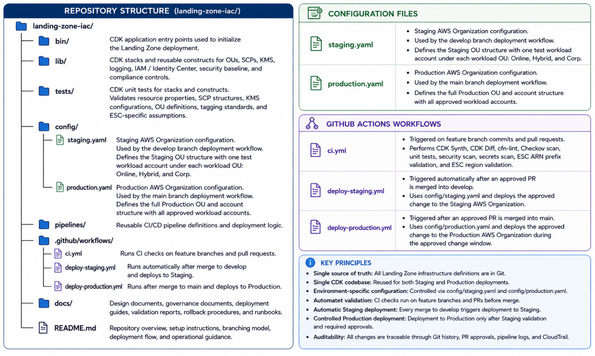
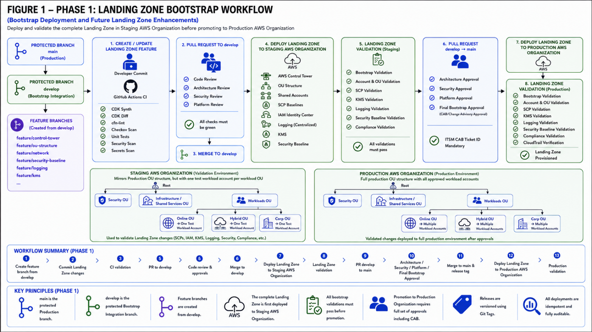
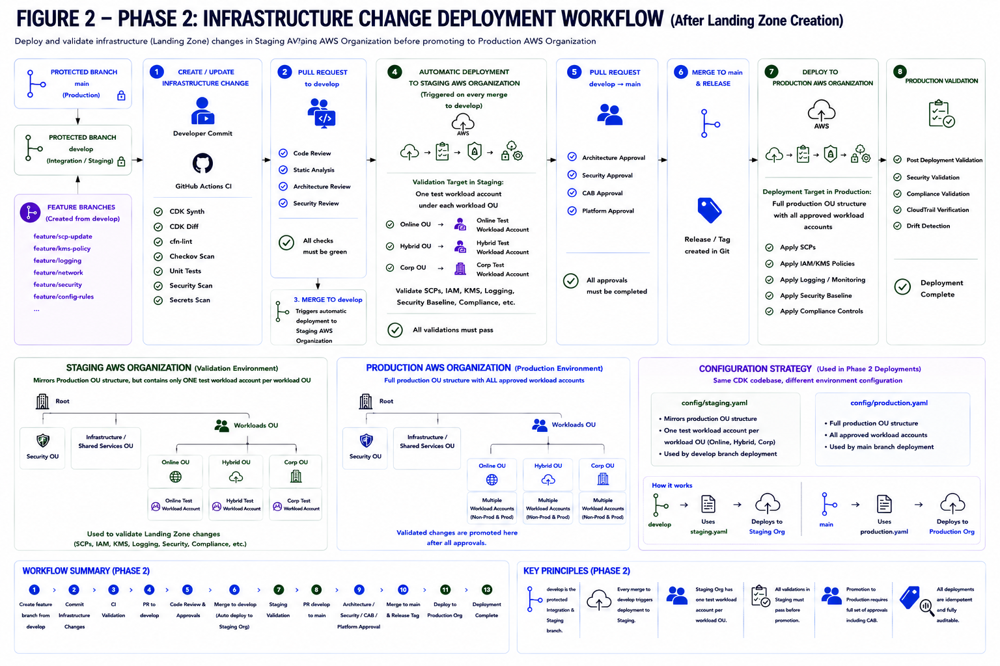

**AWS European Sovereign Cloud**

**GitOps CI/CD Pipeline, Branching Strategy & PR Governance Model**

*Landing Zone IaC Deployment Governance - Design Phase Deliverable*

*Region: eusc-de-east-1 \| Partition: aws-eusc \| Brandenburg, Germany*

| **Document ID**                             | US-1542070 \| ESC-GITOPS-DESIGN-v1.0                                                                                                                                                    |
|---------------------------------------------|-----------------------------------------------------------------------------------------------------------------------------------------------------------------------------------------|
| **Phase**                                   | Design Phase - GitOps CI/CD Pipeline, Branching Strategy & PR Governance Catalogue (No implementation code)                                                                             |
| **Version**                                 | 1.0 - June 2026                                                                                                                                                                         |
| **Platform**                                | AWS ESC \| Partition: aws-eusc \| Region: eusc-de-east-1 \| Tooling: AWS CDK (TypeScript) + GitHub Actions                                                                              |
| **Classification**                          | Confidential - For Internal If Insurance Use Only                                                                                                                                       |
| **Companion Docs**                          | ESC SCP Design Catalogue (US-1542064), ESC Security Baseline (US-1542065), ESC KMS & Encryption Strategy (US-1542066), ESC Centralized Logging Strategy (US-1542069) - cross-referenced |
| **Frameworks Alignment (Design Reference)** | BSI C5:2020 \| NIS2 Art.21 \| ISO 27001:2022 A.14 \| NIST SP 800-53 (Informative)                                                                                                       |
| **Status**                                  | Draft - Pending Stakeholder Review and Approval (WI-1543685)                                                                                                                            |

# Table of Contents

[Introduction [3](#introduction)](#introduction)

[Purpose [3](#purpose)](#purpose)

[Scope [3](#scope)](#scope)

[1. GitOps Design Overview [4](#gitops-design-overview)](#gitops-design-overview)

[1.1 Work Package Completion Matrix [4](#work-package-completion-matrix)](#work-package-completion-matrix)

[2. GitOps Operating Model (WI-1543673) [6](#gitops-operating-model-wi-1543673)](#gitops-operating-model-wi-1543673)

[2.1 ESC-Specific GitOps Facts and AWS Organization Structure [6](#esc-specific-gitops-facts-and-aws-organization-structure)](#esc-specific-gitops-facts-and-aws-organization-structure)

[2.2 AWS Organization Structure [7](#aws-organization-structure)](#aws-organization-structure)

[2.3 GitOps Principles [8](#gitops-principles)](#gitops-principles)

[3. Repository Branching & Promotion Strategy (WI-1543674) [8](#repository-branching-promotion-strategy-wi-1543674)](#repository-branching-promotion-strategy-wi-1543674)

[3.1 Repository Structure [8](#repository-structure)](#repository-structure)

[3.2 Branch Model [9](#branch-model)](#branch-model)

[3.2 Promotion Flow [10](#promotion-flow)](#promotion-flow)

[4. PR Review & Approval Standards (WI-1543675) [14](#pr-review-approval-standards-wi-1543675)](#pr-review-approval-standards-wi-1543675)

[4.1 PR Requirements [14](#pr-requirements)](#pr-requirements)

[4.2 Automated CI Pipeline Checks (Required to Pass Before Human Review) [14](#automated-ci-pipeline-checks-required-to-pass-before-human-review)](#automated-ci-pipeline-checks-required-to-pass-before-human-review)

[4.3 Human Reviewer Requirements [15](#human-reviewer-requirements)](#human-reviewer-requirements)

[4.4 ESC-Specific Security Reviewer Checklist [16](#esc-specific-security-reviewer-checklist)](#esc-specific-security-reviewer-checklist)

[4.5 Landing Zone Validation – Staging and Production [16](#landing-zone-validation-staging-and-production)](#landing-zone-validation-staging-and-production)

[5. Deployment Approval & Governance Controls (WI-1543677) [17](#deployment-approval-governance-controls-wi-1543677)](#deployment-approval-governance-controls-wi-1543677)

[5.1 Deployment Windows [17](#deployment-windows)](#deployment-windows)

[5.2 Change Advisory Board (CAB) Process [17](#change-advisory-board-cab-process)](#change-advisory-board-cab-process)

[6. Rollback Approach (WI-1543683) [17](#rollback-approach-wi-1543683)](#rollback-approach-wi-1543683)

[6.1 Rollback Principles [17](#rollback-principles)](#rollback-principles)

[6.2 Rollback Procedures by Change Type [18](#rollback-procedures-by-change-type)](#rollback-procedures-by-change-type)

[6.3 Rollback Decision Tree [18](#rollback-decision-tree)](#rollback-decision-tree)

[7. Governance Validation Matrix [19](#governance-validation-matrix)](#governance-validation-matrix)

[8. Stakeholder Review & Approval (WI-1543685) [20](#stakeholder-review-approval-wi-1543685)](#stakeholder-review-approval-wi-1543685)

[8.1 Review Process [20](#review-process)](#review-process)

[8.2 Key Review Points for Client [20](#key-review-points-for-client)](#key-review-points-for-client)

[8.3 Approval Sign-Off [21](#approval-sign-off)](#approval-sign-off)

# Introduction

This document defines the GitOps CI/CD Pipeline, Branching Strategy, and Pull Request (PR) Governance Model for Infrastructure as Code (IaC) deployments in the AWS European Sovereign Cloud (ESC) Landing Zone for If Insurance. It governs how all Landing Zone infrastructure changes - SCPs, KMS keys, logging configuration, and security baseline controls are proposed, reviewed, approved, and deployed.

The model is organised in two phases. Phase 1 (Landing Zone Bootstrap) provisions and validates the complete Landing Zone first in the Staging AWS Organization, then in the Production AWS Organization after all approvals. Phase 2 (Infrastructure Change Deployment) governs all subsequent infrastructure changes using the same Staging → Production model. Both phases share an identical branch workflow: feature/\* → develop (triggers automatic CDK deploy to Staging AWS Organization) → Staging Validation → develop→main (approvals) → Production AWS Organization.

The develop branch is the Integration and Staging deployment branch. Every merge to develop triggers an automatic CDK deployment to the Staging AWS Organization. There is no separate staging branch between develop and main.

The Staging AWS Organization mirrors the Production OU hierarchy and governance model (Security OU, Infrastructure / Shared Services OU, Workloads OU with Online, Hybrid and Corp sub-OUs), but contains only ONE representative test workload account per workload OU rather than the full Production workload account set. This is sufficient to validate SCP enforcement, KMS key access, logging delivery, Security Baseline controls and Compliance posture before Production promotion.

## Purpose

This document has been prepared by the Cloud Engineering team of Hexaware to provide If Insurance's Cloud Governance Board, Information Security, and Compliance functions with a complete and reviewable GitOps governance model prior to implementation.

The key objectives of this document are to:

- Establish a single, auditable path for every infrastructure change from code commit to production deployment in the ESC Landing Zone

- Ensure every merge to develop triggers an automatic CDK deploy to the Staging AWS Organization - errors are caught immediately, not accumulated across multiple features. 

- Define the branching and promotion strategy that enforces environment segregation and prevents untested changes from reaching production

- Use a Staging AWS Organization that mirrors the Production OU structure but contains only one test workload account per workload OU (Online / Hybrid / Corp), sufficient to validate SCP, KMS, Logging, Security Baseline and Compliance changes. 

- Use the same CDK codebase for Staging and Production deployments, with environment selection via config/staging.yaml and config/production.yaml

- Define the PR review and approval standards that ensure every change is peer-reviewed, security-verified, and correctly scoped to the aws-eusc partition before deployment

- Define the deployment approval and governance controls that link infrastructure changes to the companion SCP/KMS/Logging/Security Baseline design decisions

- Define a documented rollback approach that allows any deployment to be safely and quickly reversed

- Require Staging validation results as evidence in every CAB RFC before Production deployment is approved. 

## Scope

This document is limited to the design phase of the GitOps operating model for the ESC Landing Zone. It defines what governance processes and standards will be implemented and does not include implementation-level details.

**In scope:**

- GitOps operating model for IaC deployment using AWS CDK (TypeScript) and GitHub Actions

- Repository branching and promotion flow for Phase 1 (Landing Zone Bootstrap) and Phase 2 (Infrastructure Change Deployment)

- Pull request review and approval standards including the ESC-specific reviewer checklist

- Deployment approval and governance controls including the Change Advisory Board (CAB) process for production

- Staging and Production validation activities

- Rollback procedure for infrastructure deployments

**Out of Scope:**

- AWS CDK construct-level implementation code - this will be covered in the implementation phase

- Application-layer CI/CD pipelines - this document governs Landing Zone IaC only, not workload application code

- Detailed GitHub Actions workflow YAML - implementation phase deliverable

- SIEM/Sentinel integration configuration - see companion Logging document

# 1. GitOps Design Overview

This section defines the complete GitOps CI/CD Pipeline, Branching Strategy, and PR Governance Model for the ESC Landing Zone. This is a design-phase deliverable that describes what will be implemented, not how.

This document governs how every control defined in the companion SCP, KMS, Logging, and Security Baseline documents is deployed. No control defined in those documents takes effect until a change passes the PR review, Staging validation, and all required approvals.

## 1.1 Work Package Completion Matrix

| **Work Item** | **Type**       | **Title**                                                                                     | **Addressed In**                             | **Status**   |
|---------------|----------------|-----------------------------------------------------------------------------------------------|----------------------------------------------|--------------|
| **1542070**   | **User Story** | Define GitOps CI/CD Pipeline, Branching Strategy, and PR Governance Model for IaC Deployments | Sections 2–8 (full model)                    | **Complete** |
| **1543673**   | **Task**       | Define GitOps operating model for Infrastructure as Code deployment                           | Section 2 - GitOps Operating Model           | **Complete** |
| **1543674**   | **Task**       | Define repository branching and promotion strategy                                            | Section 3 - Branching & Promotion Strategy   | **Complete** |
| **1543675**   | **Task**       | Define pull request review and approval standards                                             | Section 4 - PR Review & Approval Standards   | **Complete** |
| **1543677**   | **Task**       | Define deployment approval and governance controls                                            | Section 5 - Deployment Approval & Governance | **Complete** |
| **1543683**   | **Task**       | Define rollback approach for infrastructure deployments                                       | Section 6 - Rollback Approach                | **Complete** |
| **1543684**   | **Task**       | Document GitOps standards and governance model                                                | This document (Sections 1–8)                 | **Complete** |
| **1543685**   | **Task**       | Conduct stakeholder review and obtain approval                                                | Section 8 - Stakeholder Review & Sign-off    | **Pending**  |

# 2. GitOps Operating Model (WI-1543673)

## 2.1 ESC-Specific GitOps Facts and AWS Organization Structure

The ESC partition uses different STS and service endpoints from commercial AWS. GitHub Actions OIDC integration must be configured explicitly for the ESC partition - using the ESC STS endpoint (**sts.eusc-de-east-1.amazonaws.eu**) and ESC ARN prefix (arn:aws-eusc:). CDK must be bootstrapped in both the Staging and Production AWS Organizations before first deployment.

| **Attribute**               | **Value**                                                                            | **Design Implication**                                                                                                                                                                                                                                                                                                                                                                                                                                                                              |
|-----------------------------|--------------------------------------------------------------------------------------|-----------------------------------------------------------------------------------------------------------------------------------------------------------------------------------------------------------------------------------------------------------------------------------------------------------------------------------------------------------------------------------------------------------------------------------------------------------------------------------------------------|
| IaC Tooling                 | **AWS CDK (TypeScript)**                                                             | Supported in ESC since August 2025. Region configured per stack. ARN prefix must be arn:aws-eusc: throughout.                                                                                                                                                                                                                                                                                                                                                                                       |
| CI/CD Platform              | **GitHub Actions**                                                                   | OIDC-based authentication to ESC - no stored long-lived AWS credentials in GitHub Secrets. ESC OIDC provider uses arn:aws-eusc: ARN prefix.                                                                                                                                                                                                                                                                                                                                                         |
| AWS Authentication          | **OIDC (OpenID Connect) - keyless**                                                  | GitHub Actions assumes a CDK pipeline IAM role in ESC via OIDC token exchange against the ESC STS endpoint. No AWS_ACCESS_KEY_ID or AWS_SECRET_ACCESS_KEY stored in GitHub.                                                                                                                                                                                                                                                                                                                         |
| ESC STS Endpoint            | **sts.eusc-de-east-1.amazonaws.eu**                                                  | Must be configured explicitly in the GitHub Actions aws-actions/configure-aws-credentials step. Default commercial endpoint (sts.amazonaws.com) will not work.                                                                                                                                                                                                                                                                                                                                      |
| Configuration Strategy      | **Same CDK codebase, different config files**                                        | develop branch uses config/staging.yaml → deploys to Staging AWS Organization. main branch uses config/production.yaml → deploys to Production AWS Organization.                                                                                                                                                                                                                                                                                                                                    |
| Staging AWS Organization    | **Validation environment - ONE test workload account per workload OU**               | Mirrors the Production OU hierarchy and governance structure (Security OU, Infrastructure/Shared Services OU, and Workloads OU with Online, Hybrid, and Corp sub-OUs), but contains a reduced set of representative workload accounts for validation. The Staging AWS Organization includes one test workload account per workload OU rather than the full Production account population, enabling SCP, KMS, Logging, and Security Baseline changes to be validated prior to Production deployment. |
| Production AWS Organization | **Live environment - full workload accounts**                                        | Full production OU structure with all approved workload accounts (Non-Prod and Prod) under each workload OU. Changes only promoted here after Staging validation and all approvals.                                                                                                                                                                                                                                                                                                                 |
| develop branch deployment   | **Every merge to develop triggers automatic CDK deploy to Staging AWS Organization** | No separate manual trigger required. The CD pipeline fires on every merge to develop, deploying using config/staging.yaml. This ensures every change is validated in Staging immediately - errors are caught at the point of merge, not accumulated.                                                                                                                                                                                                                                                |
| CDK Bootstrap               | **Required per AWS Organization**                                                    | CDK must be bootstrapped in both Staging and Production AWS Organizations before the first Landing Zone deployment. Bootstrap resources, including deployment roles and CDK asset storage, must use the arn:aws-eusc: partition and the eusc-de-east-1 region. Phase 1 validates this bootstrap readiness before/alongside Landing Zone stack deployment.                                                                                                                                           |
| Workflow idempotency        | **Both phases are idempotent**                                                       | CDK/CloudFormation applies only required changes. Drift detection confirms alignment in both Staging and Production.                                                                                                                                                                                                                                                                                                                                                                                |

## 2.2 AWS Organization Structure

The table below defines the OU and account structure of both the Staging and Production AWS Organizations, as confirmed with If Insurance.

| **OU / Account**                    | **Staging AWS Organization**                                                                                                                             | **Production AWS Organization**                                                    |
|-------------------------------------|----------------------------------------------------------------------------------------------------------------------------------------------------------|------------------------------------------------------------------------------------|
| Root                                | **Present**                                                                                                                                              | **Present**                                                                        |
| Security OU                         | **Present - same as Production**                                                                                                                         | **Present**                                                                        |
| Infrastructure / Shared Services OU | **Present - same as Production**                                                                                                                         | **Present**                                                                        |
| Workloads OU                        | **Present - same as Production**                                                                                                                         | **Present**                                                                        |
| Online OU (under Workloads OU)      | ONE test workload account only                                                                                                                           | Multiple workload accounts (Non-Prod & Prod)                                       |
| Hybrid OU (under Workloads OU)      | ONE test workload account only                                                                                                                           | Multiple workload accounts (Non-Prod & Prod)                                       |
| Corp OU (under Workloads OU)        | ONE test workload account only                                                                                                                           | Multiple workload accounts (Non-Prod & Prod)                                       |
| Purpose                             | Validate Landing Zone changes (SCPs, KMS, Logging, Security Baseline, Compliance, IAM) against representative test accounts before Production promotion. | Full production environment - validated changes promoted here after all approvals. |
| CDK configuration                   | config/staging.yaml                                                                                                                                      | config/production.yaml                                                             |

**Note:** The Staging AWS Organization mirrors the Production OU hierarchy and governance model, but contains a limited number of representative workload accounts for validation purposes.

## 2.3 GitOps Principles

The following principles govern every IaC change in the ESC Landing Zone:

- Git is the single source of truth - the state of every Landing Zone resource is fully described by the code in the repository. No manual console changes are permitted in any managed ESC account.

- Every change is a pull request - no direct commits to protected branches (main or develop)

- Every merge to develop triggers automatic Staging deployment, errors are caught immediately at the point of merge, not accumulated.

- Staging before Production - all Staging validations must pass before a PR to main is raised.

- Same code, different config - develop uses config/staging.yaml; main uses config/production.yaml.

- No human credentials stored in the pipeline - GitHub Actions authenticates to ESC exclusively via OIDC, using short-lived tokens. No AWS access keys are stored in GitHub Secrets.

- Every deployment is idempotent - running the same CDK deploy twice produces the same result. CDK drift detection is run before every deployment to confirm expected vs. actual state.

- Every deployment leaves an audit trail - CloudTrail captures every CDK/CloudFormation action in eusc-de-east-1. GitHub Actions logs capture every pipeline execution. Both are retained per the companion Logging document.

- Releases are versioned using Git Tags. Every merge to main creates a Git Tag.

- ESC partition correctness is automatically enforced - pipeline lint checks fail immediately if any arn:aws: prefix is detected (must be arn:aws-eusc:) or if any non-ESC region is referenced.

# 3. Repository Branching & Promotion Strategy (WI-1543674)

## 3.1 Repository Structure

All Landing Zone IaC code is maintained in a single GitHub repository. The repository contains CDK TypeScript code for both deployment phases - Phase 1 (Control Tower OU structure) and Phase 2 (SCPs, KMS, Logging, Security Baseline, etc.).

- **Phase 1 – Landing Zone Bootstrap:** Control Tower/Landing Zone initialization, OU structure, shared foundational accounts, baseline governance controls, logging, KMS, and security baseline.

- **Phase 2 – Infrastructure Change Deployment:** Ongoing Landing Zone and governance updates, including SCP changes, KMS policy updates, logging updates, IAM / Identity Center changes, security baseline enhancements, and compliance controls.

The same CDK codebase is used for both Staging and Production deployments. Environment-specific behaviour is controlled through configuration files under the config/ folder.

 

This repository structure is indicative and is intended to show how the GitOps model separates CDK application code, reusable infrastructure constructs, environment-specific configuration, automated tests, pipeline definitions, and operational documentation. The same CDK codebase is used for both Staging and Production. The develop branch uses **config/staging.yaml** and deploys automatically to the Staging AWS Organization, while the main branch uses **config/production.yaml** and deploys to the Production AWS Organization after Staging validation and required approvals.

The **tests/** folder ensures that CDK stacks and reusable constructs are validated before deployment. These tests help detect incorrect resource definitions, SCP structures, KMS configurations, OU definitions, tagging issues, and ESC-specific configuration issues during the CI stage.

The **config/** folder enables the same CDK implementation to be safely deployed to different AWS Organizations without duplicating infrastructure code. This keeps the solution consistent while allowing the Staging AWS Organization to remain lightweight and representative, and the Production AWS Organization to contain the full approved workload account structure.

## 

## 3.2 Branch Model

Branch names (main, develop, feature/\*) are identical in Phase 1 and Phase 2. What differs is the CI check set on the PR to develop, and the configuration file used for deployment.

<table>
<colgroup>
<col style="width: 17%" />
<col style="width: 23%" />
<col style="width: 26%" />
<col style="width: 32%" />
</colgroup>
<tbody>
<tr class="odd">
<td><strong>Branch</strong></td>
<td><strong>Role and Protection</strong></td>
<td><strong>Approval required to merge</strong></td>
<td><strong>What happens after merge</strong></td>
</tr>
<tr class="even">
<td><strong>main</strong></td>
<td>Protected Production branch. No direct commits. Source of truth for the live Production AWS Organization.</td>
<td><strong>Phase 1:</strong> Architecture Approval + Security Approval + Platform Approval + Final Bootstrap Approval (CAB). ITSM CAB Ticket ID mandatory. <strong>Phase 2:</strong> Architecture Approval + Security Approval + CAB Approval + Platform Approval. ITSM CAB Ticket ID mandatory.</td>
<td>Automatic CDK deployment to the Production AWS Organization using config/production.yaml. Git Tag is created. <strong>Phase 1:</strong> Full Landing Zone deployed + Landing Zone Validation (Production). <strong>Phase 2:</strong> Infrastructure changes applied to full OU structure + Production Validation.</td>
</tr>
<tr class="odd">
<td><strong>develop</strong></td>
<td>Protected Integration &amp; Staging branch. No direct commits. Acts as both the code integration gate and the Staging deployment trigger. <strong>Phase 1 label:</strong> Bootstrap Integration. <strong>Phase 2 label:</strong> Integration / Staging.</td>
<td>
<strong>Phase 1:</strong> Code Review + Architecture Review + Security Review + Platform Review. All CI checks green. <strong>Phase 2:</strong> Code Review + Static Analysis + Architecture Review + Security Review. All CI checks green. All automated pipeline checks

must pass before review.
</td>
<td>Every merge to develop triggers automatic CDK deploy to the Staging AWS Organization using config/staging.yaml. Staging validation runs against the one test workload account per workload OU. All validations must pass before PR to main is raised.</td>
</tr>
<tr class="even">
<td><strong>feature/*</strong></td>
<td>Developer working branch. Not protected. Created from develop in both phases.</td>
<td>None required to commit. CI pipeline runs on every push: CDK Synth, CDK Diff, cfn-lint, Checkov Scan, Unit Tests, Security Scan, Secrets Scan.</td>
<td>No deployment. PR raised to develop when ready. Nothing is deployed until the PR is approved and merged to develop</td>
</tr>
<tr class="odd">
<td><strong>hotfix/*</strong></td>
<td><strong>Emergency break-glass – Phase 2 Only.</strong> All CI checks still enforced</td>
<td>
IF Insurance CISO (mandatory) + Cloud Platform Lead.

Retrospective CAB within 24h.
</td>
<td>Emergency CDK deploy to Production AWS Organization. Back-merge to develop within 24 hours. Retrospective CAB within 24 hours.</td>
</tr>
</tbody>
</table>

## 3.2 Promotion Flow

**Phase 1 - Landing Zone Bootstrap (Bootstrap Deployment and Future Landing Zone Enhancements).**

Every merge to develop triggers automatic CDK deploy to the Staging AWS Organization. Landing Zone Validation must pass in Staging before PR to main is raised.

| **Step** | **From → To**                      | **Trigger**                                                                   | **Gate / Action**                                                                                                                                                                                                                                                                                          |
|----------|------------------------------------|-------------------------------------------------------------------------------|------------------------------------------------------------------------------------------------------------------------------------------------------------------------------------------------------------------------------------------------------------------------------------------------------------|
| 1        | develop → feature/\*               | Engineer creates feature branch from develop for each Landing Zone component. | No approval - free development.                                                                                                                                                                                                                                                                            |
| 2        | Commits on feature/\*              | Engineer commits Landing Zone IaC changes.                                    | GitHub Actions CI: CDK Synth, CDK Diff, cfn-lint, Checkov Scan, Unit Tests, Security Scan, Secrets Scan. All must pass.                                                                                                                                                                                    |
| 3        | feature/\* → develop               | PR raised to develop.                                                         | Code Review + Architecture Review + Security Review + Platform Review. All CI checks green.                                                                                                                                                                                                                |
| 4        | Merge to develop                   | PR approved and merged.                                                       | Automatic CDK deploy triggered to the Staging AWS Organization using config/staging.yaml.                                                                                                                                                                                                                  |
| 5        | Staging AWS Organization           | CDK deploys complete Landing Zone to Staging.                                 | CDK bootstrap readiness is verified and the complete Landing Zone is deployed to the Staging AWS Organization using config/staging.yaml. This includes AWS Control Tower, OU Structure, Shared Accounts, SCP Baselines, IAM Identity Center, Logging (Centralized), KMS, and Security Baseline components. |
| 6        | Staging AWS Organization           | Landing Zone Validation (Staging).                                            | Bootstrap Validation + CDK Bootstrap Readiness + Account & OU Validation + SCP Validation + KMS Validation + Logging Validation + Security Baseline Validation + Compliance Validation. Validated against ONE test workload account per workload OU (Online / Hybrid / Corp). All validations must pass.   |
| 7        | develop → main                     | PR raised after Staging validation passes.                                    | Architecture Approval + Security Approval + Platform Approval + Final Bootstrap Approval (CAB / Change Advisory Approval). ITSM CAB Ticket ID mandatory in PR description.                                                                                                                                 |
| 8        | Merge to main                      | PR approved and merged.                                                       | Git Tag created. Scheduled deployment window confirmed.                                                                                                                                                                                                                                                    |
| 9        | main → Production AWS Organization | Automatic CDK deploy triggered using config/production.yaml.                  | AWS Control Tower, OU Structure, all Shared / Audit / Log Archive accounts, SCP Baselines, IAM Identity Center, Logging, KMS, Security Baseline deployed to Production AWS Organization.                                                                                                                   |
| 10       | Production AWS Organization        | Landing Zone Validation (Production).                                         | Bootstrap Validation + Account & OU Validation + SCP Validation + KMS Validation + Logging Validation + Security Baseline Validation + Compliance Validation + CloudTrail Verification. Landing Zone Provisioned.                                                                                          |

**Phase 2 - Infrastructure Change Deployment (After Landing Zone Creation).**

Every merge to develop triggers automatic CDK deploy to the Staging AWS Organization. Staging Validation must pass before PR to main is raised. Merge to main deploys to the full Production OU structure and creates a Git Tag.

| **Step** | **From → To**                      | **Trigger**                                                                 | **Gate / Action**                                                                                                                                                                                                                                                      |
|----------|------------------------------------|-----------------------------------------------------------------------------|------------------------------------------------------------------------------------------------------------------------------------------------------------------------------------------------------------------------------------------------------------------------|
| 1        | develop → feature/\*               | Engineer creates feature branch from develop for the infrastructure change. | No approval - free development.                                                                                                                                                                                                                                        |
| 2        | Commits on feature/\*              | Engineer commits infrastructure (Landing Zone) IaC changes.                 | GitHub Actions CI: CDK Synth, CDK Diff, cfn-lint, Checkov Scan, Unit Tests, Security Scan, Secrets Scan. All must pass.                                                                                                                                                |
| 3        | feature/\* → develop               | PR raised to develop.                                                       | Code Review + Static Analysis + Architecture Review + Security Review. All CI checks green.                                                                                                                                                                            |
| 4        | Merge to develop                   | PR approved and merged.                                                     | Automatic CDK deploy triggered to the Staging AWS Organization using config/staging.yaml.                                                                                                                                                                              |
| 5        | Staging AWS Organization           | CDK deploys infrastructure changes to Staging.                              | Changes applied to the Staging AWS Organization - validated against ONE test workload account per workload OU (Online Test, Hybrid Test, Corp Test Workload Accounts). Validates SCPs, IAM, KMS, Logging, Security Baseline, Compliance.                               |
| 6        | Staging AWS Organization           | Staging Validation.                                                         | Infrastructure Validation + SCP Validation + IAM Identity Center Validation + Logging Validation + KMS Validation + Security Baseline Validation + Compliance Validation + Drift Detection. All validations must pass.                                                 |
| 7        | develop → main                     | PR raised after Staging validation passes.                                  | Architecture Approval + Security Approval + CAB Approval + Platform Approval. ITSM CAB Ticket mandatory in PR description.                                                                                                                                             |
| 8        | Merge to main                      | PR approved and merged.                                                     | Git Tag created. Scheduled deployment window confirmed.                                                                                                                                                                                                                |
| 9        | main → Production AWS Organization | Automatic CDK deploy triggered using config/production.yaml.                | Changes applied to the full Production AWS Organization OU structure: Apply SCPs, Apply IAM / KMS Policies, Apply Logging / Monitoring, Apply Security Baseline, Apply Compliance Controls. Targets all approved workload accounts across Online, Hybrid and Corp OUs. |
| 10       | Production AWS Organization        | Production Validation.                                                      | Post Deployment Validation + Security Validation + Compliance Validation + CloudTrail Verification + Drift Detection. Deployment Complete.                                                                                                                             |

Figure 1 (**Phase 1 - Landing Zone Bootstrap Workflow**) and Figure 2 (**Phase 2 - Infrastructure Change Deployment Workflow**) are on the following pages.

**ESC-Specific Note:** *All CDK deployments target the ESC partition exclusively. The pipeline configuration explicitly sets **AWS_DEFAULT_REGION=eusc-de-east-1** and validates that no commercial AWS region or arn:aws: prefix appears in synthesized CloudFormation templates before deployment proceeds.*

***Figure 1 - Phase 1:** Landing Zone Bootstrap Workflow (Bootstrap Deployment and Future Landing Zone Enhancements). feature/\*→develop: Code Review + Architecture + Security + Platform Review; merge to develop triggers automatic CDK deploy to Staging AWS Organization (config/staging.yaml); Landing Zone Validation (Staging) - ONE test workload account per OU; develop→main: Architecture + Security + Platform + Final Bootstrap Approval (CAB); main→Production AWS Organization (config/production.yaml); Landing Zone Validation (Production).*

***Figure 2 - Phase 2:** Infrastructure Change Deployment Workflow (After Landing Zone Creation). feature/\*→develop: Code Review + Static Analysis + Architecture + Security Review; merge to develop triggers automatic CDK deploy to Staging AWS Organization (config/staging.yaml) - ONE test workload account per workload OU (Online/Hybrid/Corp); Staging Validation must pass; develop→main: Architecture + Security + CAB + Platform Approval (ITSM CAB Ticket mandatory); main→Production AWS Organization (config/production.yaml) - full OU structure with all workload accounts; Production Validation + Git Tag.*

# 4. PR Review & Approval Standards (WI-1543675)

## 4.1 PR Requirements

Every pull request in the Landing Zone repository must satisfy all of the following before it can be merged.

- PR title follows the convention: \[SCP\|KMS\|LOG\|SEC\|GITOPS\]-ESC-{brief description} (e.g. SCP-ESC: Add ec2:CreateVpc to INF-001 denied actions)

- PR description references the Azure Boards work item(s) the change addresses

- PR description includes a CDK diff summary (generated automatically by the pipeline and posted as a comment)

- All automated CI checks are green before merge is permitted (see Section 4.2)

- Required human reviewers have approved and no unresolved review comments remain (see Section 4.3)

- For develop→main PRs: ITSM CAB Ticket ID present in the PR description, and Staging validation results included in the RFC.

## 4.2 Automated CI Pipeline Checks (Required to Pass Before Human Review)

| **Check**            | **What it validates**                                                         | **Fails if**                                                   |
|----------------------|-------------------------------------------------------------------------------|----------------------------------------------------------------|
| CDK Synth            | CDK application synthesizes to CloudFormation without errors.                 | Any CDK synthesis or TypeScript compilation failure.           |
| CDK Diff             | Computes CloudFormation diff and posts as PR comment for reviewer inspection. | Informational - reviewers must read the diff before approving. |
| cfn-lint             | Structural linting of synthesized CloudFormation templates.                   | Any cfn-lint error or warning above defined severity.          |
| Checkov Scan         | Static security scanning of all IaC templates.                                | Any Checkov policy violation above defined severity.           |
| Unit Tests           | CDK unit tests confirming expected resource properties.                       | Any test failure or coverage below defined threshold.          |
| Security Scan        | Scans CDK constructs for known security misconfigurations.                    | Any misconfiguration above defined severity.                   |
| Secrets Scan         | Scans commits for hardcoded credentials, secrets, tokens, and access keys.    | Any hardcoded credential, secret, token, or access key         |
| ESC ARN Prefix Check | Scans synthesized templates for incorrect ARN prefixes.                       | Any arn:aws: prefix - must be arn:aws-eusc:.                   |
| ESC Region Check     | All region references are eusc-de-east-1.                                     | Any non-ESC region in templates or CDK code.                   |

## 4.3 Human Reviewer Requirements

| **Target PR**        | **Phase**                       | **Approvals**                                              | **Reviewer requirements**                                                                                                                                                                                                                                    |
|----------------------|---------------------------------|------------------------------------------------------------|--------------------------------------------------------------------------------------------------------------------------------------------------------------------------------------------------------------------------------------------------------------|
| feature/\* → develop | Phase 1 (Bootstrap)             | Code + Architecture + Security + Platform                  | Code Review + Architecture Review + Security Review + Platform Review. Security reviewer confirms ESC partition correctness (arn:aws-eusc:,eusc-de-east-1). Merge triggers automatic CDK deploy to Staging AWS Organization.                                 |
| develop → main       | Phase 1 (Bootstrap)             | Architecture + Security + Platform + Final Bootstrap (CAB) | Architecture Approval + Security Approval + Platform Approval + Final Bootstrap Approval (CAB). ITSM CAB Ticket ID mandatory. Staging Landing Zone Validation results must be included in the RFC. Merge triggers CDK deploy to Production AWS Organization. |
| feature/\* → develop | Phase 2 (Infrastructure Change) | Code + Static Analysis + Architecture + Security           | Code Review + Static Analysis + Architecture Review + Security Review. Security confirms ESC partition correctness. Merge triggers automatic CDK deploy to Staging AWS Organization using config/staging.yaml.                                               |
| develop → main       | Phase 2 (Infrastructure Change) | Architecture + Security + CAB + Platform                   | Architecture Approval + Security Approval + CAB Approval + Platform Approval. ITSM CAB Ticket ID mandatory. Staging Validation results required in RFC. Merge to main deploys to the full Production OU structure and creates a Git Tag.                     |
| hotfix/\* → main     | Emergency (Phase 2 only)        | CISO + Cloud Platform Lead                                 | CISO + Cloud Platform Lead. All CI checks enforced. Retrospective CAB within 24 hours. Back-merge to develop within 24 hours.                                                                                                                                |

## 4.4 ESC-Specific Security Reviewer Checklist

The IF Insurance Security Team reviewer must confirm each of the following in their PR review comment before approving any PR to develop or main:

- All ARNs use the arn:aws-eusc: prefix (no arn:aws: prefix detected)

- All region references are eusc-de-east-1 (no commercial AWS region referenced)

- SCP/RCP changes are consistent with the companion SCP Design Catalogue (US-1542064)

- KMS key changes are consistent with the companion KMS & Encryption Strategy (US-1542066)

- No plaintext secrets, access keys, or hardcoded account IDs in the diff

- CDK diff has been read and the change matches the stated PR description

- Security impact of the change has been assessed and is acceptable

## 4.5 Landing Zone Validation – Staging and Production

Landing Zone Validation is a mandatory gate in both phases. All validations must pass in the Staging AWS Organization before a PR to main is permitted. The same validation set is run in the Production AWS Organization after deployment.

| **Validation activity**               | **Staging AWS Organization**                                                                                                                                                           | **Production AWS Organization**                                                                                                                    |
|---------------------------------------|----------------------------------------------------------------------------------------------------------------------------------------------------------------------------------------|----------------------------------------------------------------------------------------------------------------------------------------------------|
| Bootstrap / Infrastructure Validation | Confirms CDK deploy completed and CDK bootstrap resources are present and usable in the Staging AWS Organization. All CloudFormation stacks are in CREATE_COMPLETE or UPDATE_COMPLETE. | Confirms full Production Landing Zone deployed successfully and CDK bootstrap resources are present and usable in the Production AWS Organization. |
| Account & OU Validation               | Confirms OU structure matches approved design. ONE test workload account present and ACTIVE under each of Online, Hybrid and Corp OUs.                                                 | Confirms all approved workload accounts (Non-Prod & Prod) are created and ACTIVE under each OU.                                                    |
| SCP Validation                        | Validates SCP attachment and enforcement against the test workload accounts in each OU.                                                                                                | Validates SCP attachment and enforcement across the full Production workload account set.                                                          |
| IAM Identity Center Validation        | Confirms permission sets are configured and assignable to the test accounts.                                                                                                           | Confirms permission sets and assignments are applied correctly across all accounts.                                                                |
| KMS Validation                        | Confirms KMS keys, key policies and cross-account access are configured correctly.                                                                                                     | Confirms KMS encryption is functioning correctly across all Production workload accounts.                                                          |
| Logging Validation                    | Confirms CloudTrail and AWS Config are enabled and log delivery to the Staging Log Archive account is functioning.                                                                     | Confirms centralized logging to the Production Log Archive account is functioning across all accounts.                                             |
| Security Baseline Validation          | Confirms Security Hub, GuardDuty and AWS Config are enabled and aggregated in Staging.                                                                                                 | Confirms Security Hub, GuardDuty and AWS Config are active and aggregated across all Production accounts.                                          |
| Compliance Validation                 | Confirms deployed state matches the approved design. No compliance drift detected.                                                                                                     | Confirms no compliance drift. Drift Detection run against Production deployment.                                                                   |
| CloudTrail Verification               | Phase 2 Staging: N/A (included in Logging Validation).                                                                                                                                 | Confirms all deployment actions are captured in CloudTrail in eusc-de-east-1 (both phases).                                                        |

# 5. Deployment Approval & Governance Controls (WI-1543677)

## 5.1 Deployment Windows

| **Environment**                                                        | **Deployment window**                                                     | **Rationale**                                                                                                                                              |
|------------------------------------------------------------------------|---------------------------------------------------------------------------|------------------------------------------------------------------------------------------------------------------------------------------------------------|
| Staging AWS Organization (triggered on merge to develop - both phases) | Business hours - Mon to Fri, 08:00–18:00 CET                              | Support team available to respond immediately. Errors caught at merge are fixed in the feature branch before accumulating. No weekend Staging deployments. |
| Production AWS Organization (triggered on merge to main - both phases) | Scheduled change window - typically Tuesday and Thursday, 10:00–12:00 CET | Minimises blast radius. Cloud Platform and Security teams available for immediate rollback.                                                                |
| Emergency hotfix (Phase 2 only)                                        | Any time - CISO approval required                                         | Emergency exception only. Retrospective CAB within 24 hours mandatory.                                                                                     |

## 5.2 Change Advisory Board (CAB) Process

Every PR develop→main in both phases requires CAB approval. The RFC must include Staging validation results as evidence before CAB will approve Production deployment.

| **\#** | **Stage**                 | **Action**                                                                                                                                                                         | **Outcome**                                                              |
|--------|---------------------------|------------------------------------------------------------------------------------------------------------------------------------------------------------------------------------|--------------------------------------------------------------------------|
| **1**  | **RFC Submission**        | If Insurance Cloud Platform submits RFC in ITSM with: PR link, CDK diff, Staging validation results (confirming all validations passed), rollback plan, deployment window request. | RFC created and assigned for CAB review                                  |
| **2**  | **CAB Review**            | CISO, Cloud Platform Lead and Compliance Officer review within 2 business days. ESC partition sovereignty confirmed. Staging validation results reviewed as evidence               | Approved or rejected with documented reason                              |
| **3**  | **Approval Recorded**     | CAB ITSM Ticket ID pasted into the PR description. Merge to main not permitted without this reference.                                                                             | PR cannot be merged without a valid CAB Ticket ID.                       |
| **4**  | **Scheduled Deployment**  | GitHub Actions CD pipeline deploys to Production AWS Organization using config/production.yaml during the confirmed change window.                                                 | CloudTrail captures all CDK and CloudFormation actions in eusc-de-east-1 |
| **5**  | **Production Validation** | Post Deployment Validation + Security Validation + Compliance Validation + CloudTrail Verification + Drift Detection. Any failure triggers rollback per Section 6.                 | Deployment confirmed or rollback triggered                               |

# 6. Rollback Approach (WI-1543683)

## 6.1 Rollback Principles

- Every production deployment must have a documented rollback plan in the RFC before CAB approval.

- All rollbacks follow the standard Staging → Production workflow — the reverted change is validated in the Staging AWS Organization before being promoted to Production, except in a declared emergency.

- Rollback is always a forward Git operation - new commit reverts the change; no force-pushing to protected branches.

- Target: rollback initiated within 30 minutes of decision for the Production AWS Organization.

- No rollback may worsen the security posture of the Landing Zone - if a rollback would temporarily remove a guardrail (e.g. an SCP protecting the Log Archive), If Insurance Security team must explicitly approve any plan that temporarily removes a guardrail.

## 6.2 Rollback Procedures by Change Type

| **Change Type**                                 | **Rollback Method**                                                                                                                       | **ESC-Specific Consideration**                                                                                                                                                   |
|-------------------------------------------------|-------------------------------------------------------------------------------------------------------------------------------------------|----------------------------------------------------------------------------------------------------------------------------------------------------------------------------------|
| **SCP / RCP change**                            | Revert Git commit → PR to develop → automatic deploy to Staging → validate → PR to main → deploy to Production.                           | SCP reverts take effect immediately on CDK deploy. Revert via Staging first ensures rollback is validated before reaching Production.                                            |
| **KMS key policy change**                       | Revert Git commit → standard Staging → Production workflow                                                                                | Key policy revert is immediate. If the change caused a decryption outage, the rollback also immediately restores decryption access. Confirm with kms:DescribeKey after rollback. |
| **CloudFormation stack change (new resource)**  | cdk destroy new stack or revert and redeploy via standard Staging → Production workflow                                                   | Destroy must not remove resources with deletion protection enabled (e.g. Log Archive S3 bucket). CDK diff must be reviewed before destroy is executed.                           |
| **CloudFormation stack change (config update)** | Revert Git commit → standard Staging → Production workflow.                                                                               | CloudTrail captures forward and reverse deployment in eusc-de-east-1.                                                                                                            |
| **OU / Account structure change**               | Revert Git commit → standard Staging → Production workflow. Full Landing Zone Validation must pass in Staging before Production rollback. | OU changes affect SCP scope. Validate thoroughly in Staging, including all three test workload OUs.                                                                              |
| **GitHub Actions pipeline / config**            | Revert workflow file via PR → merge to develop.                                                                                           | Confirm reverted pipeline still uses sts.eusc-de-east-1.amazonaws.eu and arn:aws-eusc:.                                                                                          |

## 6.3 Rollback Decision Tree

The following criteria determine when rollback is triggered vs. when the team waits for forward resolution:

- **Immediate rollback:** any SCP guardrail inadvertently weakened or removed; any KMS key rendered inaccessible causing data unavailability; any deployment that causes a Security Hub CSPM CRITICAL finding

- **Rollback within 4 hours:** any deployment that causes unexpected service degradation in a Production OU; any CDK drift detected post-deployment that was not in the approved diff

- **Forward resolution preferred:** non-critical findings; cosmetic/naming issues; configuration drift in Non-Prod or Sandbox that does not impact security posture

# 7. Governance Validation Matrix

This matrix validates that the GitOps model addresses every Landing Zone IaC governance requirement and relevant framework control. This is a design-phase validation, actual pipeline execution testing will be performed during the implementation phase.

| **Governance Requirement**                                                        | **Addressed By**                                                                         | **Framework Reference**        | **Design Coverage** |
|-----------------------------------------------------------------------------------|------------------------------------------------------------------------------------------|--------------------------------|---------------------|
| Every merge to develop triggers deploy to Staging - errors caught immediately     | Section 3.2 - automatic CDK deploy to Staging AWS Organization on every merge to develop | **BSI C5 / NIST CM-3**         | **Complete**        |
| Staging org mirrors Production OU structure with ONE test workload account per OU | Section 2.1 - org structure table; Section 3.1 - config/staging.yaml                     | **ISO 27001 A.14 / NIST CM-3** | **Complete**        |
| Every IaC change is reviewed before deployment                                    | Section 4 - PR review and approval standards                                             | **BSI C5 / NIST CM-3**         | **Complete**        |
| All LZ changes validated in Staging before Production                             | Section 3.2 - Staging validation gate in both phases; all validations must pass          | **ISO 27001 A.14 / NIST CM-3** | **Complete**        |
| Security team reviews every change to develop and main                            | Section 4.3 - Security Review on feature→develop; Security Approval on develop→main      | **NIS2 Art.21 / NIST CM-3**    | **Complete**        |
| No stored long-lived credentials in the pipeline                                  | Section 2 - OIDC keyless authentication per AWS Organization                             | **BSI C5 / NIST IA-5**         | **Complete**        |
| ESC partition correctness enforced automatically                                  | Section 4.2 – ESC ARN prefix and region checks in every CI run                           | **GDPR Art.44 / NIST SC-7**    | **Complete**        |
| Production changes require formal CAB approval with Staging evidence              | Section 5.2 - CAB RFC requires Staging validation results                                | **ISO 27001 A.14 / NIST CM-3** | **Complete**        |
| Every deployment leaves a complete audit trail                                    | Section 2.2 - CloudTrail in eusc-de-east-1 (Staging + Production) + GitHub Actions logs  | **BSI C5 / NIST AU-2**         | **Complete**        |
| No manual console changes in managed                                              | Section 2.2 - GitOps principles; SCPs enforce pipeline-role-only access                  | **BSI C5 / NIST CM-5**         | **Complete**        |
| All deployments are idempotent                                                    | Section 2.1 -CDK/CloudFormation state comparison; drift detection in both orgs           | **BSI C5 / NIST CM-3**         | **Complete**        |
| Releases versioned using Git Tags                                                 | Section 3.2 - Git Tag created on every merge to main                                     | **BSI C5 / NIST AU-2**         | **Complete**        |
| Rollback plan documented for every production change                              | Section 5.2 (RFC includes rollback plan) + Section 6                                     | **BSI C5 / NIST CP-10**        | **Complete**        |
| Secrets never committed to the repository                                         | Section 4.2 - Secrets scan in automated pipeline checks                                  | **BSI C5 / NIST IA-5**         | **Complete**        |

# 8. Stakeholder Review & Approval (WI-1543685)

## 8.1 Review Process

- This document is distributed to all stakeholders for a 5-business-day review window, consistent with the process used for the companion SCP, KMS, Logging, and Security Baseline documents.

- A review meeting is held on Day 6 to resolve open comments before sign-off.

- Any unresolved comment from the Security, Compliance, or Cloud Governance Board stakeholder blocks sign-off.

## 8.2 Key Review Points for Client

| **Design decision**                                          | **Detail**                                                                                                                                                                                                                                                                                                                                                                                                                                                                                                                                                                                               |
|--------------------------------------------------------------|----------------------------------------------------------------------------------------------------------------------------------------------------------------------------------------------------------------------------------------------------------------------------------------------------------------------------------------------------------------------------------------------------------------------------------------------------------------------------------------------------------------------------------------------------------------------------------------------------------|
| develop is the Integration and Staging deployment branch     | The develop branch serves two purposes: (1) it is the code integration gate where PR reviews are completed, and (2) every merge to develop triggers an automatic CDK deployment to the Staging AWS Organization. There is no separate staging branch between develop and main. This was confirmed with the IF team - the develop branch IS the staging deployment branch.                                                                                                                                                                                                                                |
| Every merge to develop triggers automatic Staging deployment | On every merge to develop, the GitHub Actions CD pipeline fires automatically using config/staging.yaml. This ensures every change is deployed to Staging immediately at the point of merge, not accumulated. An error in one feature will be caught as soon as it is merged to develop - not discovered later when a different engineer promotes to Staging.                                                                                                                                                                                                                                            |
| Staging AWS Organization structure - confirmed by client     | The Staging AWS Organization mirrors the Production OU hierarchy and governance model, including the Security OU, Infrastructure / Shared Services OU, and Workloads OU (with Online, Hybrid, and Corp sub-OUs). To maintain a lean validation environment, it contains one representative test workload account per workload OU rather than the full Production account set. This approach, confirmed by If Insurance, is sufficient to validate SCP enforcement, IAM controls, KMS access, logging, security baseline controls, and compliance requirements before changes are promoted to Production. |
| Same CDK codebase, different configuration                   | The same CDK codebase is used for both Staging and Production deployments. The environment is selected via the configuration file: config/staging.yaml for develop branch deployments (one test workload account per OU) and config/production.yaml for main branch deployments (full workload accounts). This ensures the code path is identical - only the target accounts differ.                                                                                                                                                                                                                     |
| CAB RFC requires Staging validation evidence                 | The RFC submitted to the CAB before any production deployment must include the Staging validation results as evidence that the change has been validated. The CAB reviews the Staging validation report alongside the CDK diff and rollback plan before approving Production deployment.                                                                                                                                                                                                                                                                                                                 |
| Git Tag on every merge to main                               | Every merge to the **main** branch in both phases creates a **Git Tag**. This provides a versioned, auditable record of every change promoted to the Production AWS Organization.                                                                                                                                                                                                                                                                                                                                                                                                                        |
| Rollback always via Staging first                            | All rollbacks follow the same Staging → Production workflow: the reverted change is deployed to the Staging AWS Organization and validated before being promoted to Production. The only exception is a declared emergency (hotfix path), which requires CISO approval and a mandatory retrospective CAB within 24 hours.                                                                                                                                                                                                                                                                                |
| Roles and responsibilities                                   | Hexaware: writes all CDK TypeScript code; builds and maintains GitHub Actions CI and CD pipelines; manages branch-protection rules; executes CDK deployments to both Staging and Production AWS Organizations via OIDC. If Insurance: owns all ESC AWS Organizations and resources; approves all PRs at required gates; provides ITSM CAB Ticket ID for production deployments; grants Hexaware minimum necessary OIDC deploy role access per AWS Organization - no standing credentials.                                                                                                                |

## 8.3 Approval Sign-Off

| **Role**                                  | **Name** | **Date** | **Signature** |
|-------------------------------------------|----------|----------|---------------|
| **Cloud Platform Architect**              |          |          |               |
| **CISO / Security Lead**                  |          |          |               |
| **Cloud Governance Board Representative** |          |          |               |
| **Compliance Officer**                    |          |          |               |
