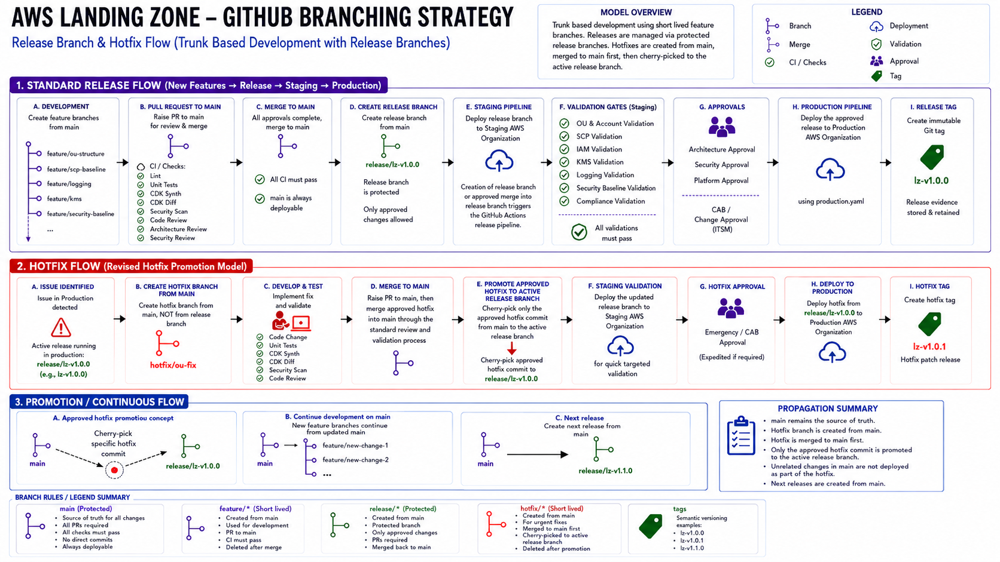
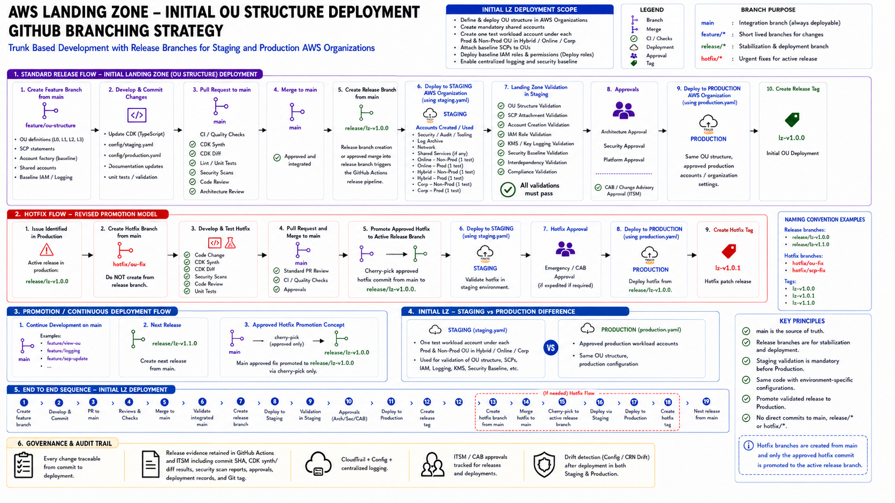

**AWS European Sovereign Cloud**

**Initial Landing Zone OU Structure Deployment  
GitHub Branching Strategy**

**Trunk-Based Development with Protected Release Branches and Controlled Hotfix Flow**

| **Document Version**        | 1.0                                                      |
|-----------------------------|----------------------------------------------------------|
| **Status**                  | Client Review Draft                                      |
| **Reference Scenario**      | Initial Landing Zone OU Structure Deployment             |
| **Deployment Environments** | Staging AWS Organization and Production AWS Organization |
| **Prepared For**            | Client Cloud Platform, Security and Architecture Teams   |

*Purpose: Define the complete branch lifecycle from feature development through release, Staging validation, Production deployment, hotfix execution, and promotion of approved hotfixes to the active release branch.*

# 1. Purpose and Context

This document describes the proposed GitHub branching and deployment model for the first deployment of the AWS Landing Zone OU structure. The model removes the long-lived develop branch and adopts trunk-based development with short-lived feature branches, protected release branches, and a controlled hotfix path.

The objective is to provide a simple and auditable flow in which main remains the central integration branch, release branches represent deployable and supportable production baselines, and hotfixes are implemented through the standard development process, merged into main, and selectively promoted to the active release branch for deployment.

# 2. Initial Landing Zone Deployment Scope

The initial deployment reference includes the following Landing Zone capabilities:

- Definition and deployment of the approved AWS Organizations OU hierarchy.

- Creation of mandatory shared accounts such as Security/Audit/Tooling, Log Archive, Network, and Shared Services where approved.

- Creation of one test workload account under each Prod and Non-Prod OU beneath Hybrid, Online, and Corp for initial validation.

- Attachment of approved Service Control Policies to the correct OU levels.

- Deployment of baseline IAM roles and permissions, including deployment and break-glass access patterns.

- Configuration of KMS, centralized logging, security baseline, compliance controls, and validation checks.

- Validation of repeatable and idempotent deployment behaviour before Production promotion.

# 3. Branching Model Overview

The proposed model uses four branch types. Each branch has a distinct purpose and deployment responsibility.

<table>
<colgroup>
<col style="width: 20%" />
<col style="width: 19%" />
<col style="width: 20%" />
<col style="width: 20%" />
<col style="width: 20%" />
</colgroup>
<thead>
<tr class="header">
<th><strong>Branch Type</strong></th>
<th><strong>Created From</strong></th>
<th><strong>Primary Purpose</strong></th>
<th><strong>Deployment Behaviour</strong></th>
<th><strong>Lifecycle</strong></th>
</tr>
</thead>
<tbody>
<tr class="odd">
<td>main</td>
<td>N/A</td>
<td>Central integration branch and source of all future development</td>
<td>CI validation only; no direct Production deployment</td>
<td>Permanent and protected</td>
</tr>
<tr class="even">
<td>feature/*</td>
<td>main</td>
<td>Short-lived implementation of OU, SCP, account, logging, KMS or security changes</td>
<td>CI checks and PR validation only</td>
<td>Deleted after merge</td>
</tr>
<tr class="odd">
<td>release/*</td>
<td>Approved and validated commit from main</td>
<td>Stabilization, Staging validation and Production deployment</td>
<td>
Automatically deploys to Staging. Production deployment occurs only

after successful Staging validation and required approvals.
</td>
<td>Retained while active/supported and retired after the support period expires</td>
</tr>
<tr class="even">
<td>hotfix/*</td>
<td>main</td>
<td>Urgent correction to the version currently running in Production</td>
<td>Validated in Staging, approved and deployed to Production</td>
<td>
Deleted after merge to main and promotion of the approved hotfix

commit to the active release branch.
</td>
</tr>
</tbody>
</table>

# 

# 

# 4. Complete Branch Flow

> **main (protected integration branch)  
> \|  
> +-- feature/ou-structure  
> +-- feature/scp-baseline  
> +-- feature/logging  
> +-- feature/kms  
> +-- feature/security-baseline  
> \|  
> +-- CI checks + PR reviews  
> \|  
> v  
> main  
> \|  
> +-- Post-merge CI validation**
>
> **\|**  
> **+-- Create protected release branch from approved and validated main commit**  
> **v**  
> **release/lz-v1.0.0**  
> **\|**  
> **+-- Release branch creation or approved merge triggers GitHub Actions Release Pipeline**
>
> **\|  
> +-- Deploy using staging.yaml to Staging AWS Organization**
>
> **\|**  
> **+-- Staging Validation**
>
> **\|  
> +-- If issues are identified**
>
> **\| \|  
> \| +-- feature/ou-fx**
>
> **\| \|  
> \| +-- PR to main**
>
> **\| \|  
> \| +-- Approved fix promoted to release/lz-v1.0.0**
>
> **\| \|  
> \| +-- Redeploy and revalidate in Staging**
>
> **\|  
> +-- Architecture / Security / Platform / CAB Approval**
>
> **\|  
> +-- Manual Production Promotion**
>
> **\|  
> +-- Deploy using production.yaml to Production AWS Organization**
>
> **\|  
> +-- Production Validation**
>
> **\|  
> +-- Create Git Tag lz-v1.0.0**

**Figure 1 – Complete GitHub Branching Strategy: Release and Hotfix Flow**

**Complete branch lifecycle: feature development, release promotion, hotfix handling and promotion of approved hotfixes to the active release branch**

# 5. Standard Release Flow for a Landing Zone Deployment Phase

**1. Create a feature branch from main:**

Create a feature branch from **main** for the Landing Zone capability being implemented. Examples include **feature/ou-structure**, **feature/accounts**, **feature/logging**, **feature/security-baseline**, or **feature/kms**. The branch should contain only the scope associated with the planned deployment phase.

**2. Develop and commit the changes:**

Implement the required AWS CDK TypeScript code, infrastructure configuration, deployment parameters, validation tests, and supporting documentation required for the selected Landing Zone capability. Depending on the deployment phase, this may include OU hierarchy definitions, account provisioning logic, SCP attachments, IAM Identity Center configuration, centralized logging, KMS configuration, security controls, or other Landing Zone components.

**3. Raise a pull request to main:**

The pull request triggers mandatory validation checks including CDK synth, CDK diff, linting, unit tests, cfn-lint, Checkov, secrets scanning, architecture review, code review, and security review.

**4. Merge the feature branch to main:**

The feature branch is merged only after all required reviews, and automated validation checks have successfully completed. Direct commits to the **main** branch are prohibited.

**4A.** **Validate the integrated code in main:** Following a successful merge, an automated CI pipeline is executed against the **main** branch. This validation confirms that the integrated codebase remains stable, secure, and deployable after combining multiple approved changes. Infrastructure validation, automated testing, security scanning, and quality checks must complete successfully before the change can be considered for release.

**5. Create the protected release branch:**

When a Landing Zone release is ready for deployment, create a protected release branch from the approved and validated commit in main. Examples include release/lz-v1.0, release/lz-v1.1, release/lz-v1.2, release/lz-v2.0, or another approved Landing Zone deployment phase.

The release branch represents a versioned and deployable snapshot of the complete Landing Zone baseline approved for deployment to the Staging and Production AWS Organizations.

**6. Only the approved hotfix change is deployed through the release branch and subsequently propagated back to main.**

**:**

Creation of the protected release branch, or the merge of approved changes into a protected release branch, generates a GitHub event that triggers the GitHub Actions release pipeline.

The pipeline checks out the release branch commit, assumes the approved deployment role in the Staging AWS Organization, loads configuration values from **staging.yaml**, and executes the AWS CDK deployment process.

The pipeline automatically deploys the release branch to the Staging AWS Organization. No additional approval is required for Staging deployment.

Following successful Staging deployment and validation, the release becomes eligible for the required Architecture, Security, Platform, and CAB/change-management approvals before Production deployment.

Deployment evidence, workflow identifiers, commit SHA values, and execution logs are retained for governance, audit, and change-management purposes.

**Release Deployment Trigger:** Creation of a protected release/\* branch, or the merge of approved

changes into a protected release/\* branch, generates a GitHub event that triggers the GitHub Actions release pipeline.

Changes merged into **main** trigger integration CI validation only and must not result in deployment to either the Staging or Production AWS Organization. Deployment is permitted only from approved release/\* branches.

**7. Validate the Landing Zone in Staging:**

Execute the validation activities applicable to the deployment phase. Validation may include OU structure verification, account provisioning checks, SCP validation, IAM Identity Center validation, KMS verification, centralized logging validation, security baseline validation, compliance controls verification, and idempotency testing.

If issues are identified during Staging validation, additional fixes may be implemented through feature branches and merged into main. Approved fixes may then be promoted into the active release branch and redeployed to Staging for further validation prior to Production deployment.

**8. Obtain approvals:**

Architecture, Security, and Cloud Platform approvals are completed, followed by CAB or approved change-management authorization in accordance with the client's governance process.

**9. Deploy the same approved release code to Production:**

Deploy the exact same release branch and commit SHA that was successfully validated in the Staging AWS Organization using **production.yaml**. Environment-specific account data, organization identifiers, account IDs, role ARNs, and logging or KMS references may differ; however, the CDK code, release branch, commit SHA, deployment pipeline, and governance controls remain unchanged. This ensures that the Production deployment is based on the same validated release baseline that was previously tested in Staging.

**10. Perform Production validation and tag the release:**

Execute the Production validation activities applicable to the deployed Landing Zone capability. Following successful validation, create an immutable Git tag (for example **lz-ou-structure-v1.0.0**) and retain all associated deployment evidence, approvals, and audit records.

# 6. Staging and Production Deployment Configuration

Staging and Production are deployed from the same approved release branch and commit SHA, but each environment uses an approved configuration file. Environment-specific account data, organization identifiers, account IDs, role ARNs, and logging or KMS references may differ; however, the CDK code, release branch, commit SHA, deployment pipeline, and governance controls remain unchanged. This allows environment-specific configuration differences while ensuring that the same validated release baseline is promoted from Staging to Production.

| **Aspect**             | **Staging AWS Organization**                                                               | **Production AWS Organization**                                                                                              |
|------------------------|--------------------------------------------------------------------------------------------|------------------------------------------------------------------------------------------------------------------------------|
| Configuration file     | staging.yaml                                                                               | production.yaml                                                                                                              |
| Workload accounts      | One test account under every Prod and Non-Prod OU in Hybrid, Online and Corp               | Approved Production workload accounts; initial reference may also use one controlled account under each Prod and Non-Prod OU |
| Purpose                | Validate deployment logic, OU placement, SCPs, IAM, KMS, logging, security and compliance  | Establish the governed Production Landing Zone                                                                               |
| Environment values     | Staging Organization ID, account emails, account IDs, role ARNs and logging/KMS references | Production Organization ID, approved account data, role ARNs and production logging/KMS references                           |
| What remains identical | Release branch, commit SHA, CDK code, dependencies, pipeline version and governance checks | Release branch, commit SHA, CDK code, dependencies, pipeline version and governance checks                                   |

# 7. Hotfix Flow for Active Production Release

A hotfix is required when an urgent issue is found in the currently deployed Production release.

The hotfix is implemented through the standard pull request and validation process in main. Once approved, only the specific hotfix commit is promoted to the active release branch through a targeted cherry-pick. This ensures that main remains the source of truth while preventing unrelated changes already present in main from being included in the active Production release.

**main  
\|  
+-- create hotfix/ou-fix  
\|  
+-- implement change + CI + review  
\|  
v**

**merge to main  
\|  
+-- cherry-pick approved hotfix commit**

**to release/lz-v1.0.0**

**\|  
v**

**release/lz-v1.0.0  
\|  
+-- deploy to Staging  
+-- targeted validation  
+-- emergency/CAB approval  
+-- deploy to Production  
+-- create tag lz-v1.0.1**

While the hotfix is being developed, validated and deployed through the active release branch, normal feature development may continue in the main branch. This ensures that unreleased features and enhancements already integrated into main are not promoted unintentionally as part of the emergency Production fix. Only the approved hotfix commit is cherry-picked from main into the active release branch and deployed to Production, ensuring that unrelated changes already present in main are not included in the current release.

- The hotfix branch is created from main.

- The hotfix is merged to main through the standard pull request, review, and validation process.

- Only the approved hotfix commit is cherry-picked from main into the active release branch.

- The corrected release is validated in Staging before Production wherever technically possible.

- Production deployment follows the approved emergency or expedited CAB process.

- A patch tag such as **lz-v1.0.1** identifies the corrected Production baseline.

# 8. Promotion of an Approved Hotfix to the Active Release Branch

After a hotfix has been approved and merged into main, only the specific hotfix commit required to resolve the Production issue is promoted to the active release branch through a reviewed pull request or targeted cherry-pick.

 

This approach ensures that main remains the source of truth while preventing unrelated changes already present in main from being included in the current Production release.

 

The active release branch should not routinely receive feature or enhancement changes. Only approved hotfix commits required for the current Production baseline should be promoted.

**8A. Release Branch Retirement:**

After the Production deployment has been completed and the agreed support period has expired, the release branch is marked as closed and no further feature development is permitted on that branch.

Future deployment phases must be created from approved and validated commits in main through the creation of a new release branch representing the next deployment scope, while historical release branches are retained for audit, traceability and recovery purposes.

Any additional Production fixes required during the support window must follow the documented hotfix process, whereby the fix is first merged into main and only the approved hotfix commit is promoted to the active release branch.

# 9. Release Evidence and Audit Traceability

The model relies on GitHub, GitHub Actions and the approved ITSM process to provide end-to-end traceability. A separate S3 evidence repository is not required unless the client has a specific long-term retention or regulatory requirement.

- Change request or CAB ticket reference.

- Feature, release and hotfix pull requests with reviewer approvals.

- Commit SHA and protected release branch.

- CDK synth and CDK diff results.

- Linting, unit test, cfn-lint, Checkov, secrets scan and security scan results.

- GitHub Actions run ID and deployment status.

- CloudFormation, CloudTrail, Config and centralized logging records.

- Production release tag and hotfix patch tag.

**Figure 2 – Initial Landing Zone OU Structure Deployment: End-to-End Branching and Deployment Flow**

> 

**Initial OU deployment mapped to release, Staging validation, Production promotion, Hotfix handling and governance.**

# 10. Branch Protection and Governance Rules

<table>
<colgroup>
<col style="width: 49%" />
<col style="width: 50%" />
</colgroup>
<thead>
<tr class="header">
<th><strong>Control</strong></th>
<th><strong>Requirement</strong></th>
</tr>
</thead>
<tbody>
<tr class="odd">
<td>main protection</td>
<td>No direct commits. Pull request, CI checks and required reviews are mandatory.</td>
</tr>
<tr class="even">
<td>feature branch lifecycle</td>
<td>Created from main, kept short-lived, merged through PR and deleted after merge.</td>
</tr>
<tr class="odd">
<td>release branch protection</td>
<td>
Direct commits are prohibited. All changes require a pull request, successful CI validation, and approval from an authorized reviewer. Normal feature, enhancement, and non-emergency changes must be implemented through feature branches, merged into main, and promoted through the approved release process. Only approved hotfix changes may be merged into an active release branch through the documented hotfix process.

Deployment approvals must be enforced through GitHub environment protections or equivalent governance controls.
</td>
</tr>
<tr class="even">
<td>Release Branch Deployment Authority</td>
<td>
Only designated release managers or approved deployment administrators may create release branches and initiate

Production deployments.
</td>
</tr>
<tr class="odd">
<td>hotfix branch origin</td>
<td>
Created from main and merged through the standard pull request, review, and validation process.

Only the approved hotfix commit may be promoted to the active release branch through a targeted cherry-pick or reviewed pull request.
</td>
</tr>
<tr class="even">
<td>Staging-first deployment</td>
<td>Every normal release and hotfix is validated in Staging before Production unless an approved emergency exception exists.</td>
</tr>
<tr class="odd">
<td>Production approval</td>
<td>Architecture, Security, Platform and CAB/change approval are required according to the change classification.</td>
</tr>
<tr class="even">
<td>No manual drift</td>
<td>Manual changes are prohibited except approved break-glass actions, which must be reconciled back into code.</td>
</tr>
<tr class="odd">
<td>Tagging</td>
<td>
Production releases and hotfixes are versioned using immutable Git tags

that follow Semantic Versioning (SemVer), for example <strong>lz-v1.0.0,</strong>

<strong>lz-v1.1.0, lz-v1.1.1, and lz-v2.0.0.</strong>
</td>
</tr>
</tbody>
</table>

# 11. Executive Summary (Proposed Branching and Deployment Approach)

This section provides a summary of the proposed branching and deployment approach for the AWS European Sovereign Cloud Landing Zone implementation.

The proposed branching model keeps main as the single integration branch and removes the long-lived develop branch. This approach reduces branch divergence, simplifies hotfix management, and aligns release promotion with modern trunk-based development practices. Short-lived feature branches are created from main and merged back only after CI, code, architecture and security reviews. When a Landing Zone deployment phase is ready, a protected release branch (for example, release/lz-v1.0.0, release/ lz-v1.1.0, release/ lz-v1.1.1, or release/lz-v2.0.0) is created from an approved and validated main commit and used for both Staging and Production deployment.

The release is first deployed to the Staging AWS Organization using staging.yaml. Staging creates and validates the complete OU hierarchy and one test workload account under each Prod and Non-Prod OU in Hybrid, Online and Corp. Once OU structure, SCP, account, IAM, KMS, logging, security, compliance and idempotency checks pass, the release proceeds through Architecture, Security, Platform and CAB approvals.

Production is then deployed from the same protected release branch and commit SHA using production.yaml. Environment-specific account data, organization identifiers, account IDs, role ARNs, and logging or KMS references may differ; however, the CDK code, release branch, commit SHA, deployment pipeline, and governance controls remain unchanged.

If an urgent Production issue occurs, the hotfix is implemented through the standard development process and merged into main.

Once approved, only the specific hotfix commit is promoted to the active release branch, validated in Staging, approved, and deployed to Production.

This ensures that main remains the source of truth while preventing unrelated changes already present in main from being included in the current Production release.

# 12. Naming Convention

main

feature/ou-structure  
feature/scp-baseline  
feature/logging  
feature/kms  
feature/security-baseline

hotfix/ou-placement-fix

hotfix/scp-baseline-fix

**Examples of Release Branches**

release/lz-v1.0.0

release/lz-v1.1.0

release/lz-v1.1.1

release/lz-v2.0.0

**Examples of Production Release Tags**

lz-v1.0.0 \# Initial Production release

lz-v1.1.0 \# New backward-compatible capability release

lz-v1.1.1 \# Hotfix or patch release

lz-v2.0.0 \# Breaking change release

**12A. Release Versioning Strategy**

Release branches and Production release tags must follow Semantic Versioning (SemVer).

**PATCH (1.1.1)**  
Backward-compatible fixes and hotfixes only. No breaking changes are permitted.

**MINOR (1.1.0)**  
Backward-compatible enhancements and new Landing Zone capabilities may be introduced.

**MAJOR (2.0.0)**  
Breaking changes are permitted and may require migration, redesign, or additional release planning activities.

This versioning approach provides a consistent and auditable method for identifying Landing Zone releases, distinguishing between hotfixes, non-breaking enhancements, and releases that introduce breaking changes.

# 13. Conclusion

This model provides a clear separation between ongoing development, release stabilization, Staging validation, Production deployment and emergency remediation. It simplifies the client explanation, avoids divergence between long-lived branches, supports a safe hotfix path, and preserves the governance controls required for an AWS Landing Zone.
